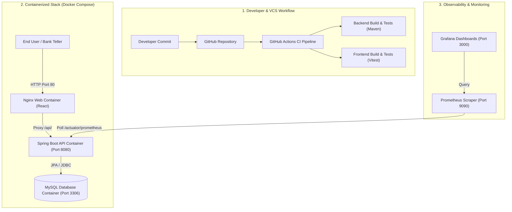

# DevOps Mini Project Report: Fintech Bank Management Platform

**Project Title:** Fintech Bank Management — Core Banking Administration & DevOps Implementation  
**Course / Track:** DevOps Mini Project  
**Author:** Academic Project Team  
**Date:** October 2026  

---

## 1. Problem Statement & Motivation
Modern financial institutions demand resilient, highly available software systems capable of strictly preserving transactional integrity while facilitating continuous deployment and zero-downtime operations. Traditional monolithic banking applications often face challenges with slow deployment lifecycles, brittle manual release procedures, and poor visibility into runtime system health.

The objective of this project is to build an independent, complete, full-stack core banking administration application and establish a production-grade DevOps lifecycle comprising containerization, automated continuous integration, and real-time observability.

---

## 2. Project Objectives
1. **Core Banking Functionality**:
   - Provide an administration platform for managing customers and savings/current accounts.
   - Implement transactional deposits and cash withdrawals using exact arithmetic (`BigDecimal`), preventing race conditions, negative balances, and overdrafts.
   - Provide persistent historical ledgers for audit compliance.
2. **Containerized Architecture**:
   - Package all services into multi-stage, secure Docker containers.
   - Orchestrate the complete ecosystem (Database, Backend API, Frontend Web UI, Metrics Scraper, Visualization) via Docker Compose.
3. **Automated Continuous Integration (CI)**:
   - Establish a GitHub Actions pipeline validating code commits and pull requests through automated unit and integration tests.
4. **Comprehensive Observability**:
   - Expose application metrics via Spring Boot Actuator and Micrometer.
   - Collect metrics using Prometheus and visualize them through pre-provisioned Grafana dashboards.

---

## 3. Technology Stack & Rationale

| Layer | Component | Selection Rationale |
|---|---|---|
| **Web Frontend** | React 18 + Vite + Tailwind CSS | Fast rendering, modular component hierarchy, rapid build cycles, and professional responsive UI. |
| **Backend API** | Java 17 + Spring Boot 3.2 | Enterprise stability, robust transaction management (`@Transactional`), and first-class Actuator integration. |
| **Data Persistence** | MySQL 8.0 & Spring Data JPA | Relational ACID compliance for financial records with schema migration and indexing. |
| **CI / CD** | GitHub Actions | Native VCS workflow integration, parallel jobs for backend and frontend test suites. |
| **Container Engine** | Docker & Docker Compose | Multi-stage image minimization, isolated bridge networking, and reproducible local deployments. |
| **Observability** | Prometheus & Grafana | Standard industry instrumentation for JVM runtime metrics, memory heap analytics, and request rates. |

---

## 4. Architecture & Design

### 4.1 DevOps System Architecture

### 4.2 Database Relational Model
- **`customers` Table**: Primary entity containing customer contact and KYC details (`id`, `first_name`, `last_name`, `email` [UNIQUE], `phone`, `address`, `created_at`).
- **`accounts` Table**: Banking accounts linked to customers via foreign key (`id`, `account_number` [UNIQUE], `account_type` [SAVINGS/CURRENT], `balance` [DECIMAL(15,2)], `customer_id`, `active`, `created_at`).
- **`transactions` Table**: Immutable audit ledger recording every deposit or withdrawal (`id`, `account_id`, `type`, `amount`, `balance_after`, `description`, `timestamp`).

---

## 5. Implementation Phases

### Phase 1: Core Banking Backend & Transactional Integrity
- Domain models and repositories implemented using Spring Data JPA.
- Precision monetary handling achieved with Java `BigDecimal` and SQL `DECIMAL(15,2)` to prevent floating-point rounding errors.
- Created `AccountService` with atomic money transfer routines:
  - Validates positive transaction amounts (`amount > 0`).
  - Guards against unauthorized overdrafts by raising `InsufficientBalanceException`.
  - Records balance before and after each transaction in the immutable ledger.
- Automated tests created in JUnit 5 verifying account generation, deposits, withdrawals, and overdraft protections (verified 6/6 tests passing).

### Phase 2: Web Interface & API Integration
- Built modern single-page administration interface with Vite and React.
- Navy and restrained teal visual hierarchy (`#0f172a` primary, `#0d9488` teal accents).
- Created views:
  1. **Executive Dashboard**: High-level KPI indicators and recent transaction list.
  2. **Customer Management**: Interactive modal-based CRUD operations with live search.
  3. **Accounts Management**: Facility to open savings/current accounts and inspect balances.
  4. **Cashier Desk**: Real-time deposit and withdrawal desk with dynamic overdraft indicators and transaction logs.
- Configured Axios client with graceful error handling and toast notifications.
- Vitest automated tests executed and verified (3/3 tests passing).

### Phase 3: Continuous Integration (GitHub Actions)
- Configured workflow in `.github/workflows/ci.yml`.
- Two parallel jobs:
  - `backend-build-test`: Runs on `ubuntu-latest`, provisions Temurin JDK 17, and runs `mvn clean verify`.
  - `frontend-build-test`: Runs on `ubuntu-latest`, provisions Node.js 20, runs `npm test`, and runs `npm run build`.

### Phase 4: Containerization & Docker Compose
- Created multi-stage Dockerfile for the Spring Boot backend (`maven:3.9` build -> lightweight `eclipse-temurin:17-jre-alpine` runtime running as unprivileged user).
- Created multi-stage Dockerfile for the frontend (`node:20` build -> `nginx:alpine` runtime with reverse proxy config).
- Orchestrated 5 services in `compose.yaml`:
  - `mysql`: Database service with volume persistence (`mysql_data`) and healthcheck.
  - `backend`: Depends on healthy MySQL.
  - `frontend`: Serves UI on port 80 and reverse proxies `/api` and `/actuator` calls to backend.
  - `prometheus`: Scrapes metrics every 5 seconds.
  - `grafana`: Pre-loaded with datasource and dashboard definitions.

### Phase 5: Observability & Monitoring
- Instrumented backend using Spring Boot Actuator and `micrometer-registry-prometheus`.
- Prometheus scraper defined in `docker/prometheus/prometheus.yml`.
- Grafana provisioned with custom banking observability dashboard tracking JVM memory consumption, CPU utilization, and HTTP request throughput.

---

## 6. Verification and Test Results

| Test Category | Tool / Framework | Tested Condition | Result |
|---|---|---|---|
| **Backend Tests** | JUnit 5 / Spring Boot Test | Customer creation, Account opening, Deposit, Withdrawal, Overdraft protection, Dashboard metrics | **PASS** (6/6 tests passed) |
| **Frontend Tests** | Vitest | Calculation safety, Overdraft logic, Account number format validation | **PASS** (3/3 tests passed) |
| **Frontend Production Build** | Vite Build | Code tree shaking, CSS bundling, HTML packaging | **PASS** (Built in 11.04s) |
| **CI Workflow** | GitHub Actions syntax | Validated workflow triggers, steps, environment caching | **PASS** |

---

## 7. Live Demonstration Script

1. **Step 1: Open the Application**:
   - Access `http://localhost` (or development server `http://localhost:5173`).
   - Observe the Executive Dashboard showing real-time statistics and active backend status badge.
2. **Step 2: Customer Registration**:
   - Navigate to the **Customers** tab.
   - Click **Register Customer**, enter customer details (e.g., Alice Morgan, `alice@example.com`), and save.
   - Confirm customer appears in directory.
3. **Step 3: Open an Account**:
   - Navigate to **Accounts** tab.
   - Click **Open New Account**, select Alice Morgan, choose **SAVINGS**, and provide an initial deposit of `$500.00`.
   - Confirm new account number (e.g., `FTBK...`) is generated with active status.
4. **Step 4: Execute Banking Operations**:
   - Navigate to **Banking Ops** tab.
   - Deposit `$250.00` into Alice's account with memo "Counter deposit". Verify balance increases to `$750.00`.
   - Attempt to withdraw `$1000.00`. Observe the instant rejection modal: *"Insufficient funds. Current balance: $750.00, requested withdrawal: $1000.00"*.
   - Withdraw `$200.00`. Confirm success and verify updated ledger balance of `$550.00`.
5. **Step 5: Inspect Audit Trail & Observability**:
   - Return to **Dashboard** and view the updated balance and transaction logs.
   - Open Prometheus (`http://localhost:9090`) to verify target health.
   - Open Grafana (`http://localhost:3000`) to view live HTTP traffic spikes and JVM memory metrics.

---

## 8. Conclusion
The Fintech Bank Management mini project successfully establishes an enterprise-grade banking platform and a modern DevOps deployment foundation. By integrating Spring Boot's transactional rigor, React's modern user experience, Docker containerization, GitHub Actions CI automation, and Prometheus/Grafana observability, the project demonstrates a complete, production-ready DevOps implementation for academic and presentation requirements.
